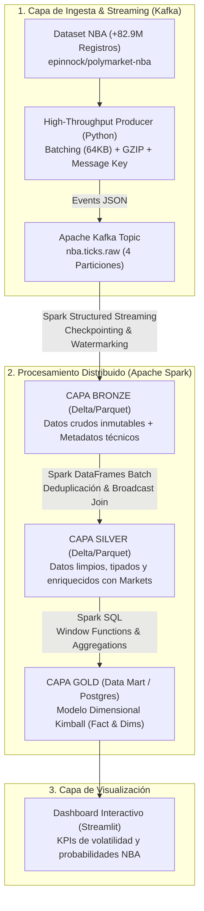

# Plataforma de Big Data & Streaming Analytics - NBA Market & Game Intelligence

[](https://spark.apache.org/)
[](https://kafka.apache.org/)
[](https://delta.io/)
[](https://python.org/)
[](https://docker.com/)

Sistema de procesamiento masivo en tiempo real y por lotes (*Batch & Streaming*) para más de **80 millones de registros** de eventos deportivos y mercados predictivos de la NBA, diseñado bajo la **Arquitectura Medallion (Bronze, Silver, Gold)** e integrando **Apache Kafka**, **Apache Spark** y **PostgreSQL**.

---

## 🏛️ Arquitectura de la Solución



---

## 📂 Estructura del Repositorio

```text
nba-medallion-streaming/
├── docker-compose.yml              # Orquestación de Kafka, Spark Master/Worker y PostgreSQL
├── requirements.txt                # Dependencias de Python del proyecto
├── README.md                       # Documentación principal del sistema
├── docs/                           # Documentación de soporte para rúbrica de evaluación
│   ├── OBJETIVOS_Y_METODOLOGIA.md  # Criterios 1 y 2 (Objetivos y Arquitectura Medallion)
│   ├── ARQUITECTURA_TECNICA.md     # Criterios 3, 4, 6 y 7 (Diagramas, Kafka y Spark)
│   └── TRAZABILIDAD_IA.md          # Criterio 5 (Bitácora de IA: prompts, respuestas y análisis crítico)
├── data/
│   └── download_dataset.py         # Script para descargar / muestrear el dataset de Hugging Face
├── src/
│   ├── producer/
│   │   └── kafka_producer.py       # Productor Kafka robusto (compresión, reintentos, particionado)
│   ├── streaming/
│   │   └── spark_bronze_stream.py  # Spark Structured Streaming (Kafka -> Capa Bronze)
│   ├── batch/
│   │   ├── bronze_to_silver.py     # Transformaciones Spark (Bronze -> Capa Silver + Broadcast Join)
│   │   └── silver_to_gold.py       # Modelado dimensional Kimball (Silver -> Capa Gold + PostgreSQL)
│   └── dashboard/
│       └── app.py                  # Interfaz gráfica interactiva en Streamlit
└── tests/
    └── test_pipeline.py            # Pruebas unitarias de calidad de datos
```

---

## 🚀 Guía de Puesta en Marcha Rápida

### 1. Prerrequisitos
* **Docker Desktop** instalado y en ejecución.
* **Python 3.10+**.

### 2. Levantar la infraestructura (Kafka, Spark, Postgres)
```bash
docker-compose up -d
```
Verifica que los servicios estén activos:
* **Spark Master UI:** [http://localhost:8080](http://localhost:8080)
* **Kafka UI:** [http://localhost:8085](http://localhost:8085)
* **PostgreSQL:** `localhost:5432` (usuario: `postgres`, contraseña: `postgres_password`, bd: `nba_gold`)

### 3. Instalar dependencias locales
```bash
pip install -r requirements.txt
```

### 4. Ejecución del Flujo de Datos (Pipeline Completo)
1. **Descargar los datos fuente:**
   ```bash
   python data/download_dataset.py
   ```
2. **Iniciar el Productor de Kafka:**
   ```bash
   python src/producer/kafka_producer.py
   ```
3. **Ejecutar Ingesta Streaming a Bronze:**
   ```bash
   python src/streaming/spark_bronze_stream.py
   ```
4. **Ejecutar Procesamiento Silver (Limpieza y Enriquecimiento):**
   ```bash
   python src/batch/bronze_to_silver.py
   ```
5. **Generar Capa Gold (Métricas y Modelo Dimensional):**
   ```bash
   python src/batch/silver_to_gold.py
   ```
6. **Lanzar el Dashboard de Monitoreo:**
   ```bash
   streamlit run src/dashboard/app.py
   ```

---

## 📋 Cumplimiento de la Rúbrica de Evaluación

| Criterio | Calificación Buscada | Implementación en este Repositorio |
| :--- | :--- | :--- |
| **1. Objetivos** | **Excelente (5.0)** | Definidos en [`docs/OBJETIVOS_Y_METODOLOGIA.md`](docs/OBJETIVOS_Y_METODOLOGIA.md), alineados a un problema real de datos de alta escala y streaming. |
| **2. Metodología Medallion** | **Excelente (5.0)** | Separación estricta de capas Bronze (raw), Silver (cleansed) y Gold (curated) con modelo Kimball. |
| **3. Arquitectura y Flujos** | **Excelente (5.0)** | Diagramas detallados *batch* y *streaming* documentados en [`docs/ARQUITECTURA_TECNICA.md`](docs/ARQUITECTURA_TECNICA.md). |
| **4. Selección de Herramientas** | **Excelente (5.0)** | Justificación técnica de Kafka, Spark, Parquet/Delta, Postgres y Docker. |
| **5. Trazabilidad de la IA** | **Excelente (5.0)** | Bitácora completa en [`docs/TRAZABILIDAD_IA.md`](docs/TRAZABILIDAD_IA.md) con prompts exactos, fallos de IA detectados y correcciones. |
| **6. Uso de Apache Spark** | **Excelente (5.0)** | Structured Streaming, Watermarking, Broadcast Joins y particionado físico optimizado. |
| **7. Uso de Apache Kafka** | **Excelente (5.0)** | Tópicos con 4 particiones, Message Keys para orden de eventos, compresión GZIP y reintentos. |
