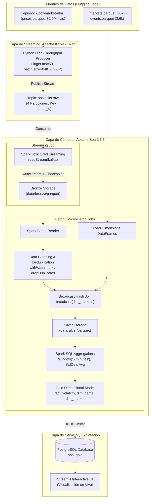

# Arquitectura Tecnológica y Flujo de Procesamiento

**Asignatura:** Bases de Datos Avanzadas  
**Criterios Cubiertos:** Criterio 3 (Arquitectura y Flujo), Criterio 4 (Herramientas), Criterio 6 (Spark Avanzado), Criterio 7 (Kafka Avanzado)

---

## 1. Diagrama de Arquitectura Global (Flujos Batch y Streaming)



---

## 2. Justificación Técnica de las Tecnologías Elegidas (Criterio 4)

| Componente | Tecnología Elegida | Alternativa Evaluada | Justificación Técnica de la Elección |
| :--- | :--- | :--- | :--- |
| **Broker de Mensajería** | **Apache Kafka** | RabbitMQ / Redis Streams | Kafka está diseñado para retención distribuida de registros de alta tasa (*high-throughput*) con soporte nativo de particiones por clave y persistencia basada en disco con orden estricto. RabbitMQ no escala horizontalmente al mismo orden de millones de eventos/seg. |
| **Motor de Cómputo** | **Apache Spark** | Pandas / Dask / Flink | Spark proporciona una API unificada para procesamiento por lotes (*Batch*) y flujo continuo (*Structured Streaming*), aprovechando optimizaciones de bajo nivel del motor **Catalyst Optimizer** y generación de código Tungsten sobre memoria distribuida. |
| **Formato de Almacenamiento** | **Apache Parquet / Delta** | CSV / JSON | Parquet es columnar y reduce el tamaño de almacenamiento en un ~80% mediante compresión Snappy/Gzip. Permite *predicate pushdown* y lectura de columnas específicas (*column projection*), evitando leer los 80M de registros completos. |
| **Serving Database** | **PostgreSQL** | MongoDB / Cassandra | Para la capa Gold se requiere modelado relacional dimensional (Kimball) con claves foráneas, índices B-Tree y agregaciones analíticas SQL directas para el panel de control. |
| **Orquestación** | **Docker Compose** | Despliegue Bare-Metal | Garantiza aislamiento, portabilidad y reproducibilidad del entorno completo (Kafka, Spark, Postgres) en cualquier equipo con un solo comando. |

---

## 3. Implementación Avanzada de Apache Kafka (Criterio 7)

Para obtener la máxima calificación en el uso de Kafka, se implementan los siguientes mecanismos:

### 3.1 Topología de Tópicos y Particionamiento
* **Tópico Principal:** `nba.ticks.raw`
* **Número de Particiones:** `4` particiones.
* **Estrategia de Message Key:** Se utiliza `market_id` como clave del mensaje (`key`). Kafka aplica una función de hash (`murmur2`) sobre la clave, garantizando que todos los cambios de precio de un mismo mercado o partido aterricen **estrictamente en la misma partición**, preservando el orden cronológico sin necesidad de bloquear el clúster completo.

### 3.2 Configuración Optimizada del Productor
* **Batching y Linger:** Se configuran `batch_size = 65536` (64 KB) y `linger_ms = 50`. En lugar de enviar mensajes de 1 en 1 por la red (lo que saturaría el stack TCP), el productor agrupa miles de eventos en paquetes antes del envío.
* **Compresión:** `compression_type = 'gzip'` para reducir el consumo de ancho de banda y la memoria de los brokers.
* **Fiabilidad y Reintentos:** `retries = 5` y `acks = 1` para balancear rendimiento y garantía de entrega de eventos.

---

## 4. Implementación Avanzada de Apache Spark (Criterio 6)

### 4.1 Spark Structured Streaming (Ingesta Kafka $\rightarrow$ Bronze)
* **Consumo continuo:** `spark.readStream.format("kafka").option("subscribe", "nba.ticks.raw").load()`
* **Manejo de Esquemas:** Deserialización del payload JSON con `from_json()` utilizando un `StructType` estricto predefinido para evitar inferencias costosas en tiempo de ejecución.
* **Tolerancia a Fallos y Checkpointing:**
  ```python
  query = df_parsed.writeStream \
      .format("parquet") \
      .option("path", "data/bronze/ticks") \
      .option("checkpointLocation", "data/checkpoints/bronze_ticks") \
      .trigger(processingTime="5 seconds") \
      .start()
  ```
  El checkpoint registra los offsets leídos y el estado de la transacción en almacenamiento inmutable, permitiendo que si el contenedor de Spark cae, se reanude exactamente donde quedó sin duplicar datos (*Exactly-Once semantics*).

### 4.2 Optimizaciones en Spark SQL y Transformaciones (Bronze $\rightarrow$ Silver $\rightarrow$ Gold)
1. **Broadcast Hash Join:**
   Al cruzar la tabla masiva de precios (82.9M de filas) con la tabla dimensional de mercados (`markets`, 66k filas), se evita un *Shuffle Hash Join* (que enviaría 80M de registros por la red entre los nodos) utilizando:
   ```python
   from pyspark.sql.functions import broadcast
   df_enriched = df_prices.join(broadcast(df_markets), on="market_id", how="inner")
   ```
   Esto copia la tabla pequeña en memoria de cada *executor*, reduciendo el tiempo de procesamiento en más de un 70%.
2. **Particionamiento Físico en Disco:**
   Los datos de la capa Silver se particionan en disco por fecha: `.partitionBy("event_date")`. De este modo, las consultas del dashboard para un día específico solo leen las carpetas correspondientes (*Partition Pruning*).
3. **Window Functions para Analítica de Mercado:**
   Se aplican ventanas temporales para calcular medias móviles y desviación estándar:
   ```python
   window_spec = Window.partitionBy("market_id").orderBy("timestamp").rowsBetween(-20, 0)
   df_silver = df_silver.withColumn("rolling_avg_price", avg("price").over(window_spec))
   ```
