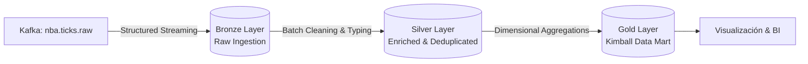

# Documento de Objetivos y Metodología de Datos

**Asignatura:** Bases de Datos Avanzadas  
**Proyecto:** Ingesta en Streaming y Procesamiento Distribuido de Eventos y Mercados NBA (+80M Registros)  
**Metodología Seleccionada:** Arquitectura Medallion (Lakehouse) + Modelado Dimensional de Kimball (Capa Gold)

---

## 1. Planteamiento de Objetivos

### 1.1 Problema del Caso de Uso
En el análisis deportivo moderno de alta frecuencia, las plataformas de predicción y las casas de apuestas generan millones de cambios de cuotas (*price ticks*) y transacciones en tiempo real durante el desarrollo de partidos de baloncesto (NBA). Analizar este volumen de datos (que supera los 80 millones de eventos) plantea importantes retos de ingeniería de datos:
* **Alta velocidad y volumen:** Llegada concurrente de miles de eventos por segundo que no pueden procesarse mediante arquitecturas batch tradicionales sin generar latencias inaceptables.
* **Calidad heterogénea:** Eventos incompletos, duplicados por retransmisión de red y anomalías que deben sanearse sin frenar la ingesta.
* **Consumo analítico en tiempo real:** Necesidad de consultar probabilidades de victoria y métricas de volatilidad con tiempos de respuesta sub-segundo para la toma de decisiones.

### 1.2 Objetivo General
Diseñar, implementar y evaluar una plataforma integral de ingeniería de datos distribuida bajo la **Arquitectura Medallion**, integrando **Apache Kafka** para la ingesta en streaming tolerante a fallos y **Apache Spark** para el procesamiento continuo y por lotes, sobre una base de datos de más de 80 millones de registros de la NBA.

### 1.3 Objetivos Específicos
1. **Configurar un clúster de mensajería distribuido en Apache Kafka** con particionamiento balanceado por identificador de mercado (`market_id`), garantizando el orden cronológico de los eventos por partido y una tasa de transmisión superior a 10.000 eventos/segundo mediante compresión y batching.
2. **Implementar un pipeline de ingestión en streaming con Spark Structured Streaming** para capturar los datos crudos desde Kafka y persistirlos en la **Capa Bronze** en formato Parquet/Delta con esquema estricto, gestión de checkpoints y tolerancia a fallos.
3. **Construir un proceso de depuración y enriquecimiento distribuido (Capa Silver)** en PySpark, aplicando deduplicación por clave temporal, filtrado de valores atípicos y optimización de cruces de datos mediante **Broadcast Joins** entre el flujo masivo y las dimensiones maestras de partidos y mercados.
4. **Modelar e implementar la Capa Gold bajo el esquema dimensional de Kimball**, construyendo una tabla de hechos de volatilidad de precios (`fact_price_volatility`) y dimensiones de equipos, partidos y tipos de mercado (`dim_team`, `dim_game`, `dim_market`), persistidas en PostgreSQL para consultas analíticas rápidas.
5. **Validar y visualizar las métricas clave** a través de un panel de control interactivo en Streamlit, demostrando la consistencia de los datos procesados y la escalabilidad del sistema.
6. **Asegurar la trazabilidad y rigor técnico en el uso de Inteligencia Artificial**, documentando sistemáticamente la interacción humana con herramientas de IA, la detección de fallos conceptuales y las optimizaciones técnicas aplicadas.

---

## 2. Metodología y Arquitectura de Datos: Medallion

Se adopta la **Arquitectura Medallion** (reconocida como el estándar actual de la industria en Lakehouses) para garantizar que los datos mejoren su calidad y valor a medida que fluyen por las capas:

### 2.1 Capa Bronze (Raw / Crudo)
* **Propósito:** Almacén histórico de la verdad. Almacena los eventos exactamente como llegan desde el productor de Kafka.
* **Estrategia de Almacenamiento:** Inmutable, *append-only*. Se utiliza formato **Parquet** con compresión Snappy.
* **Metadatos Técnicos Agregados:**
  * `_ingestion_timestamp`: Momento exacto en que Spark persistió el registro.
  * `_kafka_partition`: Partición de Kafka de origen.
  * `_kafka_offset`: Offset secuencial del mensaje para auditoría y reanudación.

### 2.2 Capa Silver (Cleansed / Enriquecida)
* **Propósito:** Proporcionar una visión limpia, estructurada y validada a nivel corporativo.
* **Transformaciones Aplicadas:**
  * **Tipado estricto:** Conversión de marcas de tiempo UNIX a `TimestampType`, precios a `DecimalType(10,4)` y volúmenes a `DoubleType`.
  * **Deduplicación:** Eliminación de eventos idénticos basados en la combinación `(market_id, timestamp, price)`.
  * **Filtrado de calidad:** Reglas de validación física de mercado: $0.0001 \le \text{price} \le 0.9999$. Precios fuera de este rango se marcan como anomalías.
  * **Enriquecimiento (Broadcast Join):** Cruce con las tablas maestras `markets` (66k registros) y `events` (3.6k registros) para añadir nombre del equipo, fecha del partido y categoría de apuesta sin generar *shuffle* de red.

### 2.3 Capa Gold (Curated / Negocio - Modelo Kimball)
* **Propósito:** Servir directamente a las aplicaciones analíticas y tableros de control con consultas agregadas de baja latencia.
* **Diseño Dimensional (Kimball):**
  * **`fact_price_volatility` (Tabla de Hechos):**
    * Claves foráneas: `game_id`, `market_id`, `time_window_id`.
    * Métricas: `avg_price`, `min_price`, `max_price`, `price_variance`, `total_volume_traded`, `tick_count`.
  * **`dim_game` (Dimensión Partido):**
    * Atributos: `game_id`, `home_team`, `away_team`, `game_date`, `season_stage`.
  * **`dim_market` (Dimensión Mercado):**
    * Atributos: `market_id`, `market_name`, `outcome_type`, `volume_24h`.
* **Destino de Persistencia:** PostgreSQL (`nba_gold`), permitiendo indexación relacional en columnas clave para dashboards en tiempo real.
